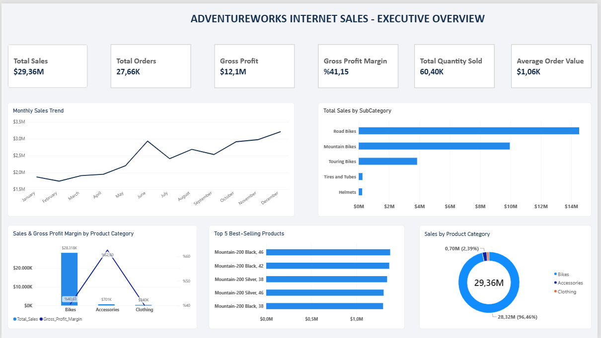
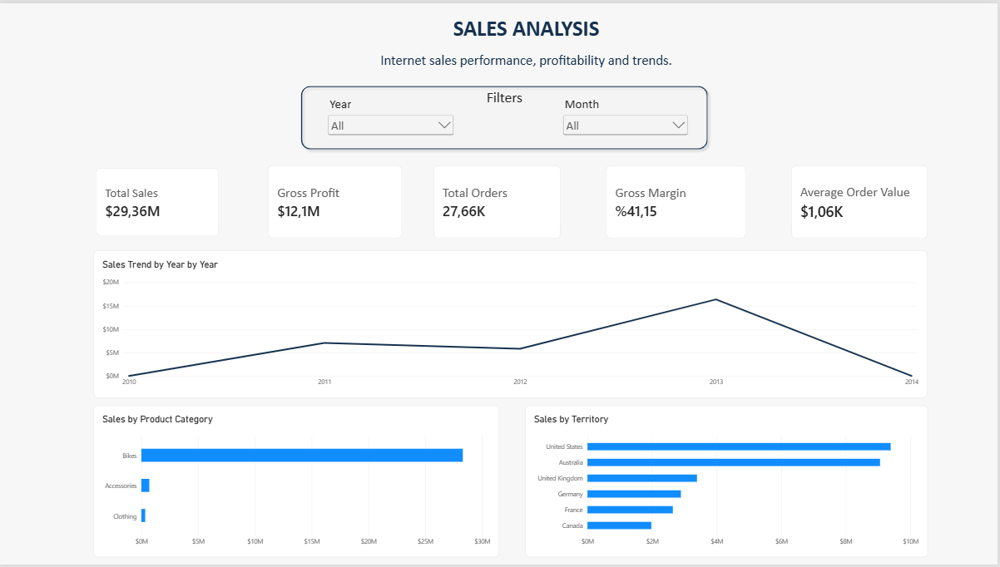
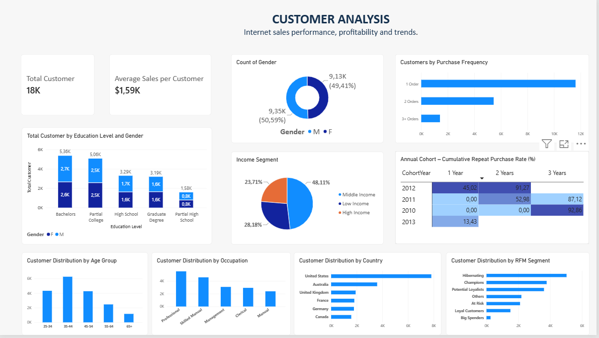
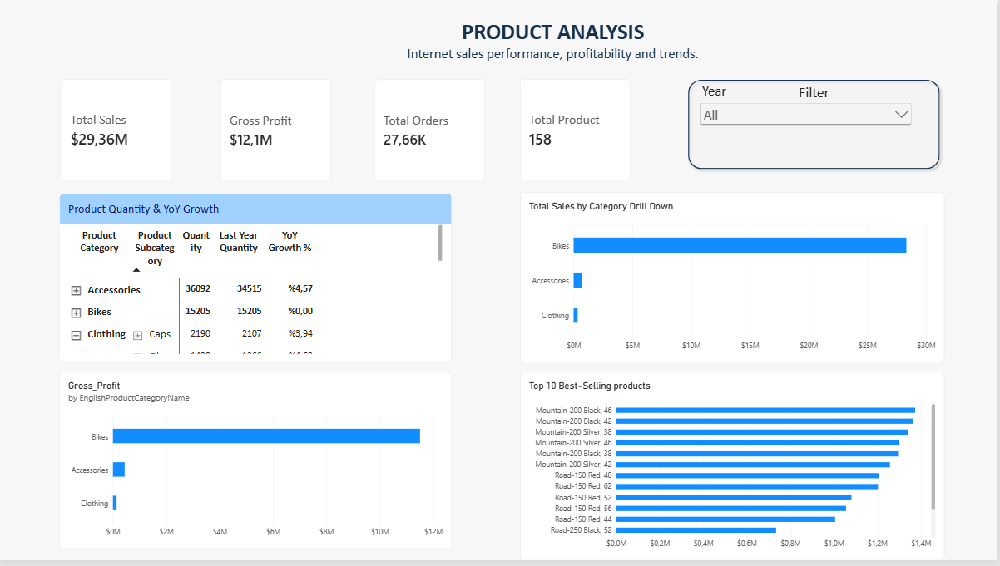
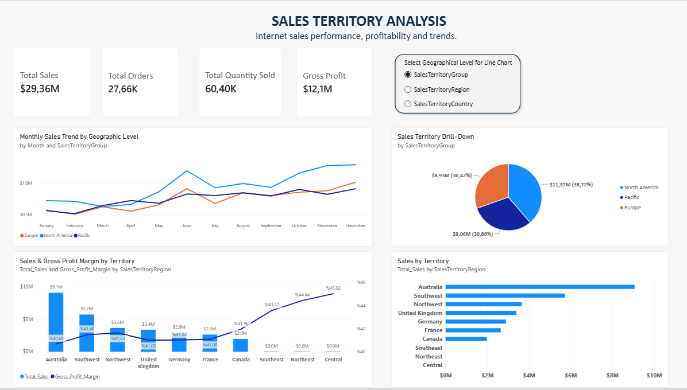

# AdventureWorksDW2022 – Power BI Sales Analysis

An interactive business intelligence project developed using **Power BI, DAX, and SQL Server** to analyze sales performance, customer behavior, product profitability, and geographical sales distribution using the AdventureWorksDW2022 dataset.

## Project Overview

This project focuses on analyzing Internet Sales data to uncover business insights and support data-driven decision-making.

The report consists of five interactive dashboard pages, providing insights into different aspects of the business.

## Dashboard Pages

### 1. Executive Overview

**Purpose:** Provides a high-level summary of overall business and sales performance.

**Key Metrics:**
- Total Sales
- Gross Profit
- Gross Profit Margin
- Total Orders
- Quantity Sold
- Average Order Value

**Analysis:** Presents an executive-level summary through KPI cards and visualizations covering sales trends, product categories, and top-performing products.

### 2. Sales Analysis

**Purpose:** Evaluates overall sales performance and profitability.

**Analysis Includes:**
- Sales trends over time
- Sales performance by product category
- Geographical sales distribution
- Revenue and profitability metrics

**Key Tables:**
- `FactInternetSales`
- `DimDate`
- `DimProduct`
- `DimProductCategory`
- `DimSalesTerritory`

### 3. Customer Analysis

**Purpose:** Explores customer characteristics, purchasing behavior, and customer segmentation.

**Analysis Includes:**
- RFM-based customer segmentation
- Customer distribution across segments
- Customer demographic analysis
- Customer purchasing behavior

**Key Tables:**
- `FactInternetSales`
- `DimCustomer`
- `DimDate`
- RFM analysis table

### 4. Product Analysis

**Purpose:** Evaluates product performance and profitability across different product levels.

**Analysis Includes:**
- Sales by product category
- Sales by subcategory
- Individual product performance
- Revenue and gross profit analysis
- Product contribution to overall sales

**Key Tables:**
- `FactInternetSales`
- `DimProduct`
- `DimProductSubcategory`
- `DimProductCategory`

### 5. Sales Territory Analysis

**Purpose:** Analyzes geographical sales performance across different territories.

**Analysis Includes:**
- Sales by territory group
- Regional sales performance
- Country-level sales analysis
- Gross profit and gross profit margin by territory
- Hierarchical geographical drill-down analysis

**Key Tables:**
- `FactInternetSales`
- `DimSalesTerritory`
- `DimDate`

## Data Model

The project follows a dimensional data modeling approach, using a central fact table connected to supporting dimension tables.

**Main Fact Table:**
- `FactInternetSales` – Contains internet sales transactions, sales amounts, costs, order quantities, and customer/product references.

**Dimension Tables:**
- `DimDate` – Date-related attributes for time-based analysis.
- `DimProduct` – Product information.
- `DimProductSubcategory` – Product subcategory information.
- `DimProductCategory` – Product category hierarchy.
- `DimCustomer` – Customer attributes.
- `DimSalesTerritory` – Geographical sales territory information.

An additional RFM analysis table is used for customer segmentation.

## Tools & Technologies

- **Power BI Desktop:** Dashboard development and data visualization.
- **DAX:** Calculated measures and business performance metrics.
- **SQL Server:** Data exploration, querying, and validation.
- **Data Modeling:** Relationships between fact and dimension tables.

## Key Metrics & DAX Measures

The report uses DAX measures to calculate business performance indicators, including:

- `Total_Sales`
- `Total_Cost`
- `Gross_Profit`
- `Gross_Profit_Margin`
- `Total_Orders`
- `Total_Quantity`
- `Average_Order_Value`

These measures support consistent calculations across the report pages.

## How to Use

1. Download the `.pbix` file from this repository.
2. Open the file using Power BI Desktop.
3. Navigate between the five dashboard pages using the report page tabs.
4. Use available slicers to filter data by relevant dimensions.
5. Interact with charts to cross-filter other visuals.
6. Use drill-down functionality on hierarchical visuals to explore detailed levels of analysis.
7. Use KPI cards to monitor key business performance indicators.

## Data Source

- **Dataset:** AdventureWorksDW2022
- **Database:** SQL Server Data Warehouse
- **Main Fact Table:** `FactInternetSales`
- **Analysis Scope:** Internet Sales

**Note:** The analysis focuses exclusively on Internet Sales, not Reseller Sales. The dataset's latest sales date is January 28, 2014, so 2014 represents a partial year.

## Project Objectives

- Develop practical business intelligence and data visualization skills.
- Apply data modeling and DAX concepts in a real-world analytical scenario.
- Validate analytical results using SQL Server.
- Perform customer segmentation and product profitability analysis.
- Transform raw sales data into meaningful business insights.

---

**Technologies:** Power BI | DAX | SQL Server
